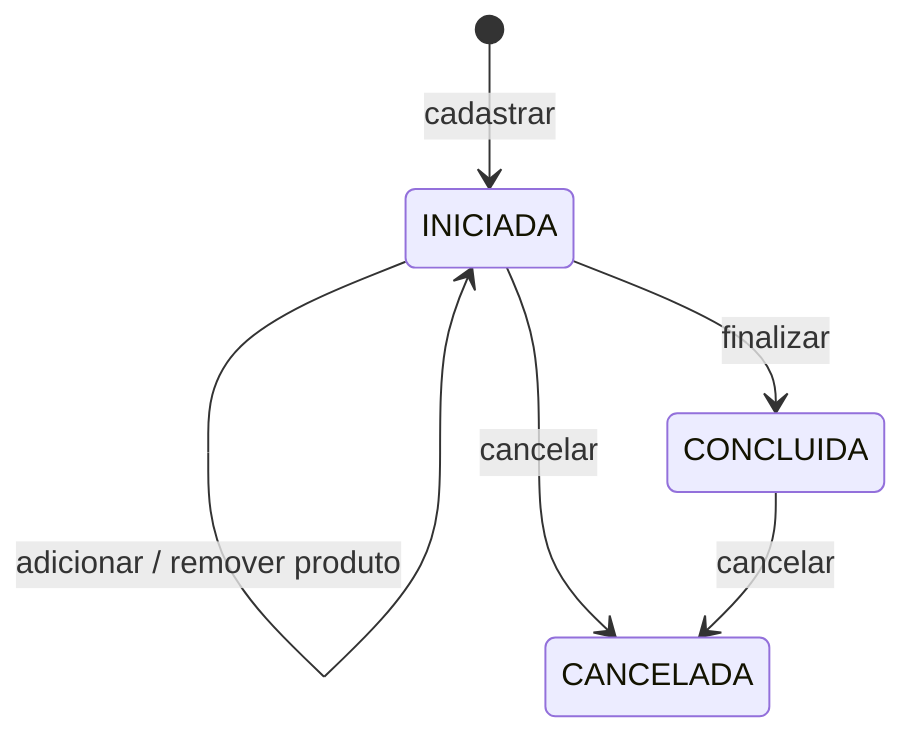
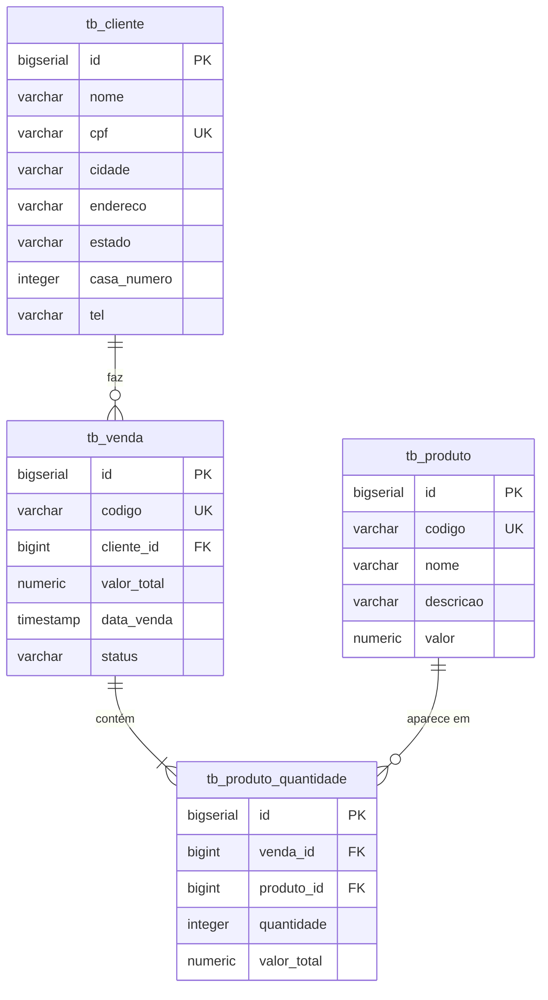

# 🛒 Módulo 30 — Cadastro de Clientes, Produtos e Vendas com JDBC + PostgreSQL

Projeto Java do curso de Back-end da **EBAC** que implementa um pequeno sistema de vendas em camadas
(**domínio → DAO → service**), persistindo os dados no **PostgreSQL** via **JDBC puro** e coberto por
**100 testes JUnit**.


---

## 📌 Funcionalidades

| Entidade | O que dá pra fazer |
|---|---|
| **Cliente** | Cadastrar, buscar por CPF, listar, atualizar e excluir |
| **Produto** | Cadastrar, buscar por código, listar, atualizar e excluir |
| **Venda** | Abrir uma venda, adicionar/remover produtos, finalizar, cancelar, listar e excluir |

### Regras de negócio (camada de service)

**Cliente**
- Nome obrigatório
- CPF com 11 dígitos — a máscara é removida (`111.111.111-11` → `11111111111`)
- Estado como sigla de 2 letras (convertido para maiúsculas)
- Número da casa positivo
- CPF não pode se repetir

**Produto**
- Código obrigatório, normalizado em maiúsculas e sem espaços nas pontas
- Nome obrigatório
- Valor maior que zero
- Código não pode se repetir

**Venda**
- Cliente e produtos precisam estar cadastrados — o preço sempre vem do produto salvo no banco
- O valor total é recalculado a cada produto adicionado ou removido
- Só é possível alterar produtos de uma venda **INICIADA**
- Só finaliza se tiver pelo menos um produto



---

## 🗂️ Estrutura do projeto

```
src
├── main
│   ├── java/br/com/ebac
│   │   ├── App.java                   # testa a conexão com o banco
│   │   ├── domain/                    # Cliente, Produto, Venda, ProdutoQuantidade
│   │   ├── dao/                       # interfaces + implementações JDBC
│   │   │   └── jdbc/ConnectionFactory # abre a conexão com o PostgreSQL
│   │   └── service/                   # validações e regras de negócio
│   └── resources
│       └── script.sql                 # criação das tabelas
└── test/java/br/com/ebac
    ├── *Test.java                     # testes de domínio, DAO e service
    └── *DAOMock.java                  # DAOs em memória usados nos testes de service
```

### Modelo de dados



A venda e seus itens são gravados **na mesma transação**: se algo falhar no meio, nada é salvo.

---

## 🚀 Como rodar

### Pré-requisitos
- Java 8 ou superior
- Maven
- PostgreSQL

### 1. Crie o banco e as tabelas

```bash
psql -U postgres -c "CREATE DATABASE ebac;"
psql -U postgres -d ebac -f src/main/resources/script.sql
```

### 2. Configure a conexão

Ajuste URL, usuário e senha em
[`ConnectionFactory.java`](src/main/java/br/com/ebac/dao/jdbc/ConnectionFactory.java):

```java
private static final String URL = "jdbc:postgresql://localhost:5432/ebac";
private static final String USER = "postgres";
private static final String PASSWORD = "admin";
```

### 3. Rode os testes

```bash
mvn test
```

---

## 🧪 Testes

| Camada | Arquivos | Usa o banco? |
|---|---|---|
| Domínio | `ClienteTest`, `ProdutoTest`, `ProdutoQuantidadeTest`, `VendaTest` | Não |
| DAO | `ClienteDAOTest`, `ProdutoDAOTest`, `VendaDAOTest`, `ConnectionFactoryTest` | Sim |
| Service | `ClienteServiceTest`, `ProdutoServiceTest`, `VendaServiceTest` | Não (usa mocks em memória) |

Os testes de DAO limpam os registros que criam, então o banco fica do jeito que estava.

---

Feito por **[Gabriel Vinces](https://github.com/gabedossa)** durante o curso de Back-end Java da EBAC.
